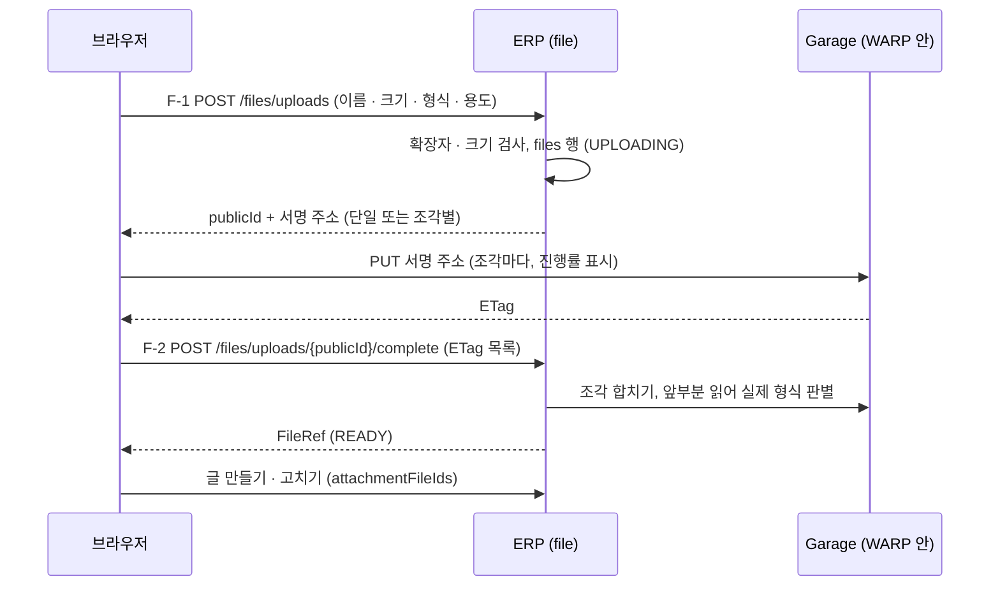

# 40. 자료실 · 파일 API (document, file)

[README](README.md) 의 공통 규칙(1.7 헤더, 1.8 공통 에러, 1.10 형식, 1.11 규칙)을 따릅니다. 경로 앞의 `/api/v1` 은 줄여 씁니다.
테이블은 [db/40-document-file.md](../db/40-document-file.md), 요구사항은 [srs/40-document.md](../srs/40-document.md) 입니다.

## 공통 모양

| 이름 | 모양 | 비고 |
|------|------|------|
| `MemberRef` | `{ memberId, name, memberType, status, photoUrl }` | README 1.4 |
| `FileRef` | `{ publicId, name, size, contentType, extension }` | `name` = `files.original_filename`, `extension` = 소문자 확장자 (`pdf`) |
| `ProjectRef` | `{ projectKey, name }` | |
| `PageResponse<T>` | `{ content, page, size, totalElements, totalPages, hasNext }` | common-code |

## 전제 (README 3장 제안)

- **[T2]** `files` 에 `status`(`UPLOADING`, `READY`) · `upload_id` 칸이 있다고 보고 씁니다. 브라우저가 Garage 로 직접 올리는 방식입니다.
- **[T3]** `document_files` 에 `file_extension` · `file_size` 를 붙일 때 복사해 둔다고 보고 씁니다 ("파일 형식" 거르기).
- **[R5]** 파일 열람 권한은 대상 모듈이 구현한 `FileTargetPolicy` 가 판단합니다.
- **Garage 주소**: 브라우저가 서명 주소로 Garage 에 직접 올리고 받으려면 Garage 가 브라우저에서 보여야 합니다. NFR-ENV-03("바깥으로 공개하지 않는다")과 맞추려면 **WARP 안의 nginx 경로로만** 엽니다 (예: `https://lab.iturtle.win/storage/`, 인터넷에는 열지 않음). 이것이 안 되면 ERP 가 받아서 넘기는 방식으로 바꿔야 하고, 그때는 F-1 · F-2 가 바뀝니다.

---

## API 목록

| 번호 | 메서드 | 경로 | 권한 | 요약 |
|------|--------|------|------|------|
| D-1 | GET | `/documents` | 로그인 | 자료 목록 · 검색 · 거르기 (고정 자료, 카테고리별 개수 포함) |
| D-2 | POST | `/documents` | 로그인 | 자료 올리기 |
| D-3 | GET | `/documents/{documentId}` | 볼 수 있음 | 자료 상세 (파일 버전, 링크, 태그) |
| D-4 | PATCH | `/documents/{documentId}` | 작성자, `content-manage` | 고치기 · 고정 · 해결 표시 · 파일 빼기 |
| D-5 | DELETE | `/documents/{documentId}` | 작성자, `content-manage`, 연결 프로젝트 PM | 지우기 (숨김, 30일 뒤 완전 삭제) |
| D-6 | POST | `/documents/{documentId}/restore` | `content-manage` | 지운 자료 되살리기 (30일 안) |
| D-7 | POST | `/documents/{documentId}/files` | 작성자, `content-manage` | 파일 더하기 (같은 이름이면 새 버전) |
| D-8 | GET | `/documents/tags` | 로그인 | 태그 자동 완성 · 많이 쓰는 태그 |
| F-1 | POST | `/files/uploads` | 로그인 | 올리기 시작 (서명 주소 받기) |
| F-2 | POST | `/files/uploads/{publicId}/complete` | 올린 사람 | 올리기 완료 (형식 검사) |
| F-3 | DELETE | `/files/{publicId}` | 올린 사람 | 아직 안 붙은 파일 지우기 · 올리기 취소 |
| F-4 | GET | `/files/{publicId}/download` | 볼 수 있음 | 내려받기 · 미리 보기 (5분 서명 주소로 302) |
| F-5 | GET | `/files/usage` | `file-manage` | 저장소 사용량 |

자료 댓글은 공통 댓글 API(`targetType = DOCUMENT`, [60](60-common.md#3-댓글-공통-규칙))를 씁니다.

---

## 1. 자료실 — DOC-1 (화면: 02 · 자료실)

### D-1. 자료 목록

`GET /api/v1/documents`

| 항목 | 내용 |
|------|------|
| 권한 | 로그인. 볼 수 없는 자료(다른 프로젝트의 "참여자만")는 목록 · 개수 · 검색에 나오지 않음 |
| 요구사항 | DOC-1-03, 04, 05, 09, 11 |
| 테이블 | `documents`, `document_tags`, `document_files`, `comments`(개수), `files`(파일 이름 검색) |
| 감사 로그 · 알림 | 없음 |

**요청 헤더** — 공통

**쿼리 파라미터**

| 이름 | 타입 | 필수 | 설명 |
|------|------|------|------|
| `categoryCode` | string | | 공통코드 `DOCUMENT_CATEGORY` 상세 코드. 없으면 전체 |
| `tag` | string | | 태그 하나 (`#` 없이) |
| `projectKey` | string | | 연결 프로젝트 (프로젝트 화면의 "자료" 탭도 이것으로 부름, DOC-1-11) |
| `authorId` | number | | 작성자 `memberId` |
| `fileType` | string | | 확장자 (`pdf`, `docx`, `zip` …). 그 형식 파일이 하나라도 있는 자료 |
| `keyword` | string | | 2자 이상. 제목 · 본문 · 파일 이름 · 태그 검색 (ngram) |
| `unresolved` | boolean | | `true` 면 "해결" 표시가 가능한 카테고리(`ref1 = Y`)에서 해결 안 된 글만 (화면 옆 칸 "해결 안 된 질문") |
| `deleted` | boolean | | `true` 면 지운 지 30일 안의 자료만. `content-manage` 만 (DOC-1-10) |
| `page`, `size`, `sort` | | | `sort` = `createdAt,desc`(기본) · `updatedAt,desc` · `commentCount,desc` |

**응답** `200 OK`

| 필드 | 타입 | 설명 |
|------|------|------|
| `pinned` | `DocumentSummary[]` | 고정 자료. `categoryCode` 가 있으면 그 카테고리 것만, 없으면 전체 고정. `page = 0` 일 때만 채움 |
| `categoryCounts` | object | `{ "PAPER": 34, … }` — 지금 거르기(카테고리 제외)를 적용한 볼 수 있는 자료 수. 탭 숫자 |
| `page` | `PageResponse<DocumentSummary>` | 고정 자료는 여기에도 다시 나오지 않음 |

`DocumentSummary`

| 필드 | 타입 | 설명 |
|------|------|------|
| `documentId` | number | |
| `categoryCode`, `categoryName` | string | |
| `title` | string | |
| `author` | `MemberRef` | |
| `project` | `ProjectRef` \| null | |
| `visibility` | `LAB` \| `PROJECT_MEMBERS` | 화면의 "참여자만" |
| `tags` | string[] | |
| `fileTypes` | string[] | 들어 있는 파일 확장자 (중복 없음). 카드의 `PDF`, `DOCX` |
| `latestVersion` | number \| null | 파일 버전 중 가장 큰 값 (`v3`). 파일 없으면 null |
| `commentCount` | number | |
| `resolved` | boolean \| null | 해결 표시 가능한 카테고리면 true/false, 아니면 null |
| `pinned` | boolean | |
| `createdAt`, `updatedAt` | string | |
| `deletedAt` | string \| null | `deleted=true` 로 불렀을 때만 |

```json
{
  "success": true,
  "data": {
    "pinned": [
      { "documentId": 3, "categoryCode": "FORM", "categoryName": "서식", "title": "연구실 주간 보고 양식",
        "author": { "memberId": 1, "name": "정재훈", "memberType": "PROFESSOR", "status": "ACTIVE", "photoUrl": null },
        "project": null, "visibility": "LAB", "tags": ["양식"], "fileTypes": ["docx"], "latestVersion": 1,
        "commentCount": 0, "resolved": null, "pinned": true,
        "createdAt": "2026-11-03T01:00:00Z", "updatedAt": "2026-11-03T01:00:00Z", "deletedAt": null }
    ],
    "categoryCounts": { "PAPER": 34, "SLIDE": 27, "DEV_DOC": 22, "DATA": 9, "FORM": 6, "QNA": 18, "FREE": 12 },
    "page": { "content": [ "…DocumentSummary…" ], "page": 0, "size": 20, "totalElements": 128, "totalPages": 7, "hasNext": true }
  },
  "error": null
}
```

**에러**

| HTTP | 코드 | 언제 |
|------|------|------|
| 400 | `D002` | `categoryCode` 가 사용 중인 카테고리가 아님 |
| 400 | `D016` | `keyword` 가 2자보다 짧음 |
| 403 | `C003` | `deleted=true` 인데 `content-manage` 없음 |

### D-2. 자료 올리기

`POST /api/v1/documents`

| 항목 | 내용 |
|------|------|
| 권한 | 로그인 (인턴 포함). `projectKey` 를 넣으면 그 프로젝트를 볼 수 있어야 하고, `PROJECT_MEMBERS` 는 그 프로젝트 참여자 또는 `project-observe` · `project-manage` |
| 요구사항 | DOC-1-01, 03, 05, 07, DOC-2-04 |
| 테이블 | `documents`, `document_files`, `document_links`, `document_tags`, `files`(`target_type = DOCUMENT` 로 붙임) |
| 감사 로그 · 알림 | 없음 |

**요청 본문**

| 필드 | 타입 | 필수 | 규칙 · 설명 |
|------|------|------|-------------|
| `categoryCode` | string | O | 사용 중인 `DOCUMENT_CATEGORY` |
| `title` | string | O | 1~200자 |
| `body` | string | | Markdown, 30,000자 이하. 붙여넣은 이미지는 `inlineImageFileIds` 로 |
| `projectKey` | string | | 연결 프로젝트 하나 |
| `visibility` | string | O | `LAB`(기본) \| `PROJECT_MEMBERS`. `PROJECT_MEMBERS` 는 `projectKey` 필수 |
| `tags` | string[] | | 10개 이하, 각 1~20자. 앞의 `#` 는 떼고 저장, 중복 제거 |
| `links` | `{ url, title }[]` | | 10개 이하. `url` 은 http/https, 500자 이하. `title` 100자 이하 |
| `files` | `{ fileId, note }[]` | | 20개 이하. `fileId` = 올리기를 끝낸(`READY`) 첨부 파일 `publicId`. `note` 200자 이하 (버전 메모). 같은 이름을 두 번 넣으면 v1 · v2 로 저장 |
| `inlineImageFileIds` | string[] | | 본문에 붙여넣은 이미지 (`purpose = INLINE_IMAGE`) |

`body` 와 `files` 중 하나는 있어야 합니다.

```json
{
  "categoryCode": "DEV_DOC",
  "title": "DEFME 배포 가이드 (Vault · Jenkins)",
  "body": "## 배포 순서\n…",
  "projectKey": "DEFME",
  "visibility": "PROJECT_MEMBERS",
  "tags": ["배포", "vault"],
  "links": [ { "url": "https://lab.iturtle.win/jenkins/job/defme_BE/", "title": "Jenkins 작업" } ],
  "files": [ { "fileId": "0f6b3c1e-2b7d-4c1a-9a7e-5d2f8b1c4e90", "note": "초안" } ],
  "inlineImageFileIds": []
}
```

**응답** `201 Created` (`Location: /api/v1/documents/212`) — 본문은 D-3 과 같은 `DocumentDetail`

**에러**

| HTTP | 코드 | 언제 |
|------|------|------|
| 400 | `D002` | 카테고리가 없거나 사용 안 함 |
| 400 | `D003` | 본문도 파일도 없음 |
| 400 | `D004` | 파일이 20개를 넘음 |
| 400 | `D005` | 링크가 10개를 넘음 |
| 400 | `D006` | 링크 주소가 http/https 가 아님 |
| 400 | `D007` | 태그가 10개를 넘거나 길이가 틀림 |
| 400 | `D008` | `PROJECT_MEMBERS` 인데 프로젝트가 없음 |
| 404 | `D009` | 프로젝트가 없거나 볼 수 없음 |
| 403 | `D010` | `PROJECT_MEMBERS` 로 올릴 수 없는 사람 (그 프로젝트 참여자 아님) |
| 400 · 403 · 409 | `F009` · `F010` · `F008` | 파일이 아직 올라가는 중 · 내가 올린 파일이 아님 · 이미 다른 글에 붙음 |

### D-3. 자료 상세

`GET /api/v1/documents/{documentId}`

| 항목 | 내용 |
|------|------|
| 권한 | 볼 수 있음. 못 보면 404 (`D001`). 지운 자료는 `content-manage` 만 (`deletedAt` 이 채워져 옴) |
| 요구사항 | DOC-1-05, 06, 07, 08 |
| 테이블 | `documents`, `document_files`, `document_links`, `document_tags`, `files` |

**경로 파라미터** — `documentId` (number)

**응답** `200 OK` — `DocumentDetail`

| 필드 | 타입 | 설명 |
|------|------|------|
| (D-1 의 `DocumentSummary` 필드 전부) | | |
| `body` | string \| null | Markdown 원문 |
| `links` | `{ linkId, url, title }[]` | `display_order` 순 |
| `files` | `DocumentFileGroup[]` | 이름(`logical_name`)별로 묶음. 이름 순 |
| `resolvedCommentId` | number \| null | 해결로 고른 댓글 |
| `permissions` | `{ canEdit, canDelete, canPin, canResolve, canRestore }` | 버튼 표시용. 서버가 다시 검사함 |

`DocumentFileGroup` = `{ logicalName, latest: DocumentFileVersion, previous: DocumentFileVersion[] }`
`DocumentFileVersion` = `{ documentFileId, version, file: FileRef, note, uploadedBy: MemberRef, createdAt }`

```json
{
  "success": true,
  "data": {
    "documentId": 212, "categoryCode": "DEV_DOC", "categoryName": "개발 문서",
    "title": "DEFME 배포 가이드 (Vault · Jenkins)",
    "author": { "memberId": 4, "name": "박지훈", "memberType": "STUDENT", "status": "ACTIVE", "photoUrl": "/api/v1/files/9a…/download?size=128" },
    "project": { "projectKey": "DEFME", "name": "DEFME 백엔드" }, "visibility": "PROJECT_MEMBERS",
    "tags": ["배포", "vault"], "fileTypes": ["md"], "latestVersion": 3, "commentCount": 2, "resolved": null, "pinned": false,
    "body": "## 배포 순서\n…",
    "links": [ { "linkId": 5, "url": "https://lab.iturtle.win/jenkins/job/defme_BE/", "title": "Jenkins 작업" } ],
    "files": [ {
      "logicalName": "deploy-guide.md",
      "latest": { "documentFileId": 31, "version": 3,
                  "file": { "publicId": "0f6b…", "name": "deploy-guide.md", "size": 18234, "contentType": "text/markdown", "extension": "md" },
                  "note": "Jenkins 작업 연결 추가", "uploadedBy": { "memberId": 4, "name": "박지훈", "memberType": "STUDENT", "status": "ACTIVE", "photoUrl": null },
                  "createdAt": "2026-11-14T05:00:00Z" },
      "previous": [ "…version 2, 1…" ] } ],
    "resolvedCommentId": null,
    "permissions": { "canEdit": true, "canDelete": true, "canPin": false, "canResolve": false, "canRestore": false },
    "createdAt": "2026-11-14T03:00:00Z", "updatedAt": "2026-11-14T05:00:00Z", "deletedAt": null
  },
  "error": null
}
```

**에러**

| HTTP | 코드 | 언제 |
|------|------|------|
| 404 | `D001` | 없음, 볼 수 없음, 지웠는데 `content-manage` 없음 |

### D-4. 자료 고치기 · 고정 · 해결 표시

`PATCH /api/v1/documents/{documentId}`

| 항목 | 내용 |
|------|------|
| 권한 | 내용 필드: 작성자, `content-manage`. `pinned`: `content-manage` 만 (DOC-1-09). `resolvedCommentId`: 작성자만 (DOC-1-06) |
| 요구사항 | DOC-1-02, 06, 09 |
| 테이블 | `documents`, `document_links`, `document_tags`, `document_files`, `files` |
| 감사 로그 · 알림 | 작성자가 아닌 사람이 `content-manage` 로 고치면 `CONTENT` / `CONTENT_EDITED` |

**요청 본문** — 넣은 필드만 바꿉니다.

| 필드 | 타입 | 규칙 · 설명 |
|------|------|-------------|
| `categoryCode`, `title`, `body`, `projectKey`, `visibility` | | D-2 와 같은 규칙. `projectKey: null` 은 연결 끊기 (`PROJECT_MEMBERS` 면 함께 `LAB` 로 바꿔야 함) |
| `tags` | string[] | 통째로 바꿈 |
| `links` | `{ url, title }[]` | 통째로 바꿈 |
| `removeFileNames` | string[] | 그 이름(`logicalName`)의 모든 버전을 자료에서 뺌. 파일은 30일 뒤 지움. 빼고 나서 본문도 파일도 없으면 `D003` |
| `inlineImageFileIds` | string[] | 본문에 새로 붙여넣은 이미지 |
| `pinned` | boolean | 카테고리 고정 · 해제 |
| `resolvedCommentId` | number \| null | 해결로 고를 댓글. null 이면 해결 취소 |

```json
{ "title": "DEFME 배포 가이드 (Vault · Jenkins) v3", "tags": ["배포", "vault", "jenkins"] }
```
```json
{ "resolvedCommentId": 881 }
```

**응답** `200 OK` — `DocumentDetail`

**에러**

| HTTP | 코드 | 언제 |
|------|------|------|
| 404 | `D001` | 없음 · 볼 수 없음 · 지운 자료 |
| 403 | `C003` | 내용을 고칠 권한 없음 |
| 403 | `D011` | `pinned` 를 바꾸는데 `content-manage` 없음 |
| 400 | `D012` | 해결 표시를 쓸 수 없는 카테고리 (`ref1 ≠ Y`) |
| 403 | `D013` | `resolvedCommentId` 를 작성자가 아닌 사람이 바꿈 |
| 400 | `D014` | 고른 댓글이 이 자료의 댓글이 아니거나 지운 댓글 |
| 400 | `D015` | `removeFileNames` 에 없는 이름 |
| 400 | `D002`~`D010` | D-2 와 같음 |

### D-5. 자료 지우기

`DELETE /api/v1/documents/{documentId}`

| 항목 | 내용 |
|------|------|
| 권한 | 작성자, `content-manage`, 연결 프로젝트의 PM (DOC-1-02) |
| 요구사항 | DOC-1-10, DOC-2-09 |
| 테이블 | `documents`(`deleted_at`, `purge_at = +30일`), `files.purge_at`, `comments`(함께 숨김) |
| 감사 로그 · 알림 | 작성자가 아닌 사람이 지우면 `CONTENT` / `CONTENT_DELETED` ("다른 사람의 자료를 숨김 · 30일 뒤 완전 삭제") |

**요청 본문** — 없음

**응답** `200 OK` — `{ "success": true, "data": { "documentId": 212, "purgeAt": "2026-12-16T09:00:00Z" }, "error": null }`

**에러**

| HTTP | 코드 | 언제 |
|------|------|------|
| 404 | `D001` | 없음 · 볼 수 없음 · 이미 지움 |
| 403 | `C003` | 지울 권한 없음 |

### D-6. 지운 자료 되살리기

`POST /api/v1/documents/{documentId}/restore`

| 항목 | 내용 |
|------|------|
| 권한 | `content-manage` |
| 요구사항 | DOC-1-10 |
| 테이블 | `documents`(`deleted_at`, `purge_at` 비움), `files.purge_at` 비움, `comments` 되살림 |
| 감사 로그 · 알림 | `CONTENT` / `CONTENT_RESTORED` |

되살리면 파일 완전 삭제 예약도 취소되므로(부수 효과) `PATCH` 필드가 아니라 동작 경로로 둡니다 (README 1.11 규칙 2).

**요청 본문** — 없음 · **응답** `200 OK` — `DocumentDetail`

**에러**

| HTTP | 코드 | 언제 |
|------|------|------|
| 404 | `D001` | 없음 (이미 완전 삭제됨 포함) |
| 409 | `D017` | 지운 자료가 아님 |
| 409 | `D018` | 지운 지 30일이 지나 정리 중 |

### D-7. 파일 더하기 (새 버전)

`POST /api/v1/documents/{documentId}/files`

| 항목 | 내용 |
|------|------|
| 권한 | 작성자, `content-manage` |
| 요구사항 | DOC-1-07 |
| 테이블 | `document_files`(`version` = 같은 `logical_name` 의 최대 + 1), `files` |
| 감사 로그 · 알림 | 없음 |

**요청 본문**

| 필드 | 타입 | 필수 | 규칙 · 설명 |
|------|------|------|-------------|
| `fileId` | string | O | `READY` 인 내 첨부 파일 |
| `logicalName` | string | | 어떤 파일의 새 버전인지. 없으면 파일 이름(`original_filename`)과 같은 이름을 찾고, 없으면 새 파일(v1) |
| `note` | string | | 버전 메모, 200자 이하 |

```json
{ "fileId": "7d0e…", "note": "Jenkins 작업 연결 추가" }
```

**응답** `201 Created` — 바뀐 `DocumentFileGroup`

**에러**

| HTTP | 코드 | 언제 |
|------|------|------|
| 404 | `D001` | 자료 없음 · 볼 수 없음 |
| 403 | `C003` | 권한 없음 |
| 400 | `D004` | 새 이름인데 이미 20개 |
| 400 | `D015` | `logicalName` 이 이 자료에 없음 |
| 400 · 403 · 409 | `F009` · `F010` · `F008` | 파일 상태 |

### D-8. 태그 자동 완성 · 많이 쓰는 태그

`GET /api/v1/documents/tags`

| 항목 | 내용 |
|------|------|
| 권한 | 로그인. 볼 수 있는 자료의 태그만 센다 |
| 요구사항 | DOC-1 데이터 항목(태그 자동 완성), 자료실 화면 "많이 쓰는 태그" |
| 테이블 | `document_tags` (`idx_document_tags_tag`) |

자동 완성과 많이 쓰는 태그는 같은 데이터(태그와 개수)라 한 API 로 둡니다 (README 1.11 규칙 1).

**쿼리 파라미터**

| 이름 | 타입 | 필수 | 설명 |
|------|------|------|------|
| `prefix` | string | | 이 글자로 시작하는 태그. 없으면 전체에서 많이 쓴 순 |
| `limit` | number | | 기본 10, 최대 30 |

**응답** `200 OK`

```json
{ "success": true, "data": [ { "tag": "세미나", "count": 14 }, { "tag": "코드리뷰", "count": 9 } ], "error": null }
```

**에러** — 공통만

---

## 2. 파일 — DOC-2

### 파일 올리기



- 글에 붙이지 않은 파일은 올린 지 24시간 뒤 정리 작업이 지웁니다 (`attach_deadline_at`, DOC-2-08).
- 글에 붙이는 것은 각 글의 API 가 합니다. 그때 file 모듈이 검사해 다음 에러를 냅니다: `F008`(이미 붙음), `F009`(`READY` 아님), `F010`(내가 올린 것 아님), `F005`(용도가 틀림 — 본문 이미지 자리에 첨부 파일 등).

### F-1. 올리기 시작

`POST /api/v1/files/uploads`

| 항목 | 내용 |
|------|------|
| 권한 | 로그인 |
| 요구사항 | DOC-2-02, 05, 07, 11 |
| 테이블 | `files` (`status = UPLOADING`, `upload_id`, `attach_deadline_at = +24시간`) **[T2 전제]** |
| 감사 로그 · 알림 | 없음 |

**요청 본문**

| 필드 | 타입 | 필수 | 규칙 · 설명 |
|------|------|------|-------------|
| `filename` | string | O | 1~255자. 경로 문자(`/`, `\`)는 뗀다 |
| `size` | number | O | 바이트. 용도별 최대(공통코드 `FILE_POLICY`): `ATTACHMENT` 200MB, `INLINE_IMAGE` 10MB, `PROFILE_PHOTO` 5MB |
| `contentType` | string | O | 브라우저가 알려 준 형식. 서명 주소에 넣어 Garage 가 같은 값으로만 받게 함. 실제 형식은 F-2 에서 다시 판별 |
| `purpose` | string | O | `ATTACHMENT` \| `INLINE_IMAGE` \| `PROFILE_PHOTO` |

- 막는 확장자(`FILE_POLICY.BLOCKED_EXTENSIONS`, 기본 `.exe .bat .cmd .ps1 .sh .msi .js .vbs .jar` 등)는 **마지막 확장자**로 판단합니다 (`report.pdf.exe` 거절).
- 용도별 허용 형식: `INLINE_IMAGE` = jpg · png · gif · webp, `PROFILE_PHOTO` = jpg · png · webp. SVG 는 이미지 용도로 받지 않습니다 (DOC-2-06).
- 16MB 이하는 `SINGLE`, 넘으면 `MULTIPART`(조각 16MB, 200MB = 13조각).

```json
{ "filename": "erd-v2.pdf", "size": 1258291, "contentType": "application/pdf", "purpose": "ATTACHMENT" }
```

**응답** `201 Created` (`Location: /api/v1/files/0f6b…`)

| 필드 | 타입 | 설명 |
|------|------|------|
| `publicId` | string | 이 파일의 ID (UUID) |
| `mode` | `SINGLE` \| `MULTIPART` | |
| `single` | object \| null | `{ url, method: "PUT", headers: { "Content-Type": "…" } }` |
| `multipart` | object \| null | `{ partSize, parts: [ { partNumber, url } ] }` — 조각마다 `PUT`, 응답 헤더 `ETag` 를 모아 F-2 로 보냄 |
| `expiresAt` | string | 서명 주소 만료 (발급 + 1시간). 내려받기의 5분과 다름 |

```json
{
  "success": true,
  "data": {
    "publicId": "0f6b3c1e-2b7d-4c1a-9a7e-5d2f8b1c4e90",
    "mode": "SINGLE",
    "single": { "url": "https://lab.iturtle.win/storage/erp-files/2026/11/0f6b…?X-Amz-Signature=…", "method": "PUT",
                "headers": { "Content-Type": "application/pdf" } },
    "multipart": null,
    "expiresAt": "2026-11-18T03:00:00Z"
  },
  "error": null
}
```

**에러**

| HTTP | 코드 | 언제 |
|------|------|------|
| 400 | `F012` | 파일 이름이 비었거나 255자를 넘음 |
| 400 | `F002` | 막힌 확장자 |
| 400 | `F003` | 용도별 최대 크기를 넘음 |
| 400 | `F005` | 이 용도에 쓸 수 없는 형식 |
| 502 | `F011` | Garage 에 연결하지 못함 |

### F-2. 올리기 완료

`POST /api/v1/files/uploads/{publicId}/complete`

| 항목 | 내용 |
|------|------|
| 권한 | 올린 사람 |
| 요구사항 | DOC-2-01, 05, 07 |
| 테이블 | `files` (`status = READY`, `content_type` = 판별한 값, `size` = 실제 크기, `upload_id` 비움) |

서버는 조각을 합친 뒤(멀티파트) 객체의 앞부분을 읽어 **실제 형식**을 판별합니다. 확장자와 다르면 객체와 행을 지우고 거절합니다 (확장자를 `.png` 로 바꾼 실행 파일 거절, DOC-2 수용 기준). 압축 파일은 허용합니다.

**요청 본문**

| 필드 | 타입 | 필수 | 규칙 · 설명 |
|------|------|------|-------------|
| `parts` | `{ partNumber, etag }[]` | `MULTIPART` 면 O | 모든 조각. `SINGLE` 이면 비우거나 빼도 됨 |

```json
{ "parts": [ { "partNumber": 1, "etag": "\"9b2cf535f27731c974343645a3985328\"" }, { "partNumber": 2, "etag": "\"…\"" } ] }
```

**응답** `200 OK`

| 필드 | 타입 | 설명 |
|------|------|------|
| (`FileRef`) | | `publicId`, `name`, `size`, `contentType`, `extension` |
| `purpose` | string | |
| `status` | `READY` | |
| `attachDeadlineAt` | string | 이때까지 글에 붙이지 않으면 지움 |

```json
{ "success": true, "data": { "publicId": "0f6b…", "name": "erd-v2.pdf", "size": 1258291, "contentType": "application/pdf",
  "extension": "pdf", "purpose": "ATTACHMENT", "status": "READY", "attachDeadlineAt": "2026-11-19T02:00:00Z" }, "error": null }
```

**에러**

| HTTP | 코드 | 언제 |
|------|------|------|
| 404 | `F001` | 없음 · 내가 올린 것 아님 |
| 409 | `F006` | 이미 완료했거나 취소한 업로드 |
| 400 | `F007` | 조각이 모자라거나, 올라간 크기가 F-1 의 `size` 와 다름 |
| 400 | `F004` | 실제 내용 형식이 확장자와 다름 (파일은 지워짐) |
| 400 | `F005` | 실제 형식이 이 용도에 맞지 않음 (예: 프로필 사진인데 이미지가 아님) |
| 502 | `F011` | Garage 에 연결하지 못함 |

### F-3. 안 붙은 파일 지우기 · 올리기 취소

`DELETE /api/v1/files/{publicId}`

| 항목 | 내용 |
|------|------|
| 권한 | 올린 사람 |
| 요구사항 | DOC-2-08 |
| 테이블 | `files`, Garage 객체 (올리는 중이면 멀티파트 취소) |

글에 이미 붙은 파일은 이 API 로 지우지 않습니다. 각 글의 고치기 API 로 빼면 30일 뒤 지워집니다 (DOC-2-09).

**요청 본문** — 없음 · **응답** `200 OK` — `data: null`

**에러**

| HTTP | 코드 | 언제 |
|------|------|------|
| 404 | `F001` | 없음 · 내가 올린 것 아님 |
| 409 | `F008` | 이미 글에 붙은 파일 |

### F-4. 내려받기 · 미리 보기

`GET /api/v1/files/{publicId}/download`

| 항목 | 내용 |
|------|------|
| 권한 | 붙은 대상을 볼 수 있음 (`FileTargetPolicy`, **[R5]**). 아직 안 붙은 파일은 올린 사람만. 프로필 사진(`MEMBER_PHOTO`)은 로그인한 누구나 |
| 요구사항 | DOC-1-08, DOC-2-03, 04, 06, MEM-1-04 |
| 테이블 | `files` (`variant_of` 로 작은 크기 찾기) |

``, `<a href>`, PDF 미리 보기 `<iframe>` 에 이 주소를 그대로 씁니다. 세션 쿠키로 권한을 확인하고 서명 주소로 보냅니다.

**쿼리 파라미터**

| 이름 | 타입 | 필수 | 설명 |
|------|------|------|------|
| `disposition` | `inline` \| `attachment` | | 기본 `attachment`. `inline` 은 **jpg · png · gif · webp · pdf 만** 받아 주고, 다른 형식은 `inline` 을 보내도 `attachment` 로 내려 준다 (SVG 포함) |
| `size` | number | | 이미지 변형 크기. 프로필 사진은 `128` \| `512`(기본). 없는 크기면 원본 |

**응답** `302 Found`

| 헤더 | 값 |
|------|----|
| `Location` | Garage 서명 주소. **5분** 뒤 만료 (6분 뒤 열면 Garage 가 거절, DOC-2 수용 기준). 서명에 `response-content-disposition`(`attachment; filename*=UTF-8''<원래 이름>` 또는 `inline`) · `response-content-type` 을 넣는다 |
| `Cache-Control` | `no-store` |

본문은 없습니다.

**에러**

| HTTP | 코드 | 언제 |
|------|------|------|
| 404 | `F001` | 없음, 볼 수 없음, 대상이 지워짐, 아직 `READY` 아님 (권한 없는 작업의 첨부도 404, DOC-2 수용 기준) |
| 502 | `F011` | Garage 에 연결하지 못함 |

### F-5. 저장소 사용량

`GET /api/v1/files/usage`

| 항목 | 내용 |
|------|------|
| 권한 | `file-manage` |
| 요구사항 | DOC-2-10 |
| 테이블 | `files` (`idx_files_uploader`, `idx_files_target`). 지운 파일(`purge_at` 대기)은 따로 셈 |

**쿼리 파라미터**

| 이름 | 타입 | 필수 | 설명 |
|------|------|------|------|
| `groupBy` | `TARGET_TYPE` \| `MEMBER` \| `PURPOSE` | O | 묶는 기준. SRS 의 "카테고리별"은 붙은 대상 종류(`TARGET_TYPE`)로 해석 |
| `page`, `size` | | | `MEMBER` 일 때 페이지 |

**응답** `200 OK`

| 필드 | 타입 | 설명 |
|------|------|------|
| `total` | `{ fileCount, bytes }` | `READY` 인 파일 전체 |
| `pendingPurge` | `{ fileCount, bytes }` | 30일 뒤 지울 파일 |
| `unattached` | `{ fileCount, bytes }` | 아직 안 붙은 파일 (24시간 정리 대상) |
| `groups` | `PageResponse<{ key, label, fileCount, bytes }>` | `key` = 대상 종류 · `memberId` · 용도 |

```json
{ "success": true, "data": {
  "total": { "fileCount": 4210, "bytes": 81604378624 },
  "pendingPurge": { "fileCount": 31, "bytes": 912680550 },
  "unattached": { "fileCount": 4, "bytes": 12582912 },
  "groups": { "content": [ { "key": "DOCUMENT", "label": "자료실", "fileCount": 2210, "bytes": 60129542144 } ],
              "page": 0, "size": 20, "totalElements": 6, "totalPages": 1, "hasNext": false } }, "error": null }
```

**에러** — 공통만

### 프로필 사진 변형

API 를 따로 두지 않습니다. `PUT /members/me/photo`([10](10-member.md))가 file 모듈 공개 API 를 부릅니다.

1. 브라우저가 F-1 · F-2 로 `purpose = PROFILE_PHOTO` 파일을 올린다.
2. member 가 `fileId` 와 자를 영역(`x`, `y`, `size`)을 file 에 넘긴다.
3. file 이 정사각형으로 잘라 **512px**(`target_type = MEMBER_PHOTO`, `target_id = memberId`)와 **128px**(`variant_of` = 512px 행, `uploaded_by_member_id = NULL`) 두 파일을 만들고, 원본은 지운다 (MEM-1-04).
4. `members.photo_file_id` = 512px 행. 화면은 `photoUrl`(`/api/v1/files/{publicId}/download?size=128`)을 그대로 쓴다.
5. 이전 사진 두 파일은 바로 지운다 (글이 아니라 보관할 이유가 없음).

---

## 에러 코드

### document (`D`)

| HTTP | 코드 | 이름 | 메시지 |
|------|------|------|--------|
| 404 | `D001` | `DOCUMENT_NOT_FOUND` | 자료를 찾을 수 없어요. |
| 400 | `D002` | `DOCUMENT_CATEGORY_NOT_FOUND` | 사용 중인 자료실 카테고리가 아니에요. |
| 400 | `D003` | `BODY_OR_FILE_REQUIRED` | 본문이나 파일 중 하나는 있어야 해요. |
| 400 | `D004` | `TOO_MANY_FILES` | 파일은 20개까지 올릴 수 있어요. |
| 400 | `D005` | `TOO_MANY_LINKS` | 링크는 10개까지 넣을 수 있어요. |
| 400 | `D006` | `INVALID_LINK_URL` | 링크는 http:// 또는 https:// 로 시작해야 해요. |
| 400 | `D007` | `INVALID_TAGS` | 태그는 10개까지, 각 1~20자로 넣어 주세요. |
| 400 | `D008` | `PROJECT_REQUIRED_FOR_MEMBERS_ONLY` | "프로젝트 참여자만"으로 올리려면 프로젝트를 골라 주세요. |
| 404 | `D009` | `LINKED_PROJECT_NOT_FOUND` | 연결할 프로젝트를 찾을 수 없어요. |
| 403 | `D010` | `MEMBERS_ONLY_NOT_ALLOWED` | 이 프로젝트의 참여자만 "프로젝트 참여자만" 자료를 올릴 수 있어요. |
| 403 | `D011` | `PIN_NOT_ALLOWED` | 자료 고정은 content-manage 역할이 있어야 해요. |
| 400 | `D012` | `RESOLVE_NOT_SUPPORTED` | 이 카테고리에서는 해결 표시를 쓸 수 없어요. |
| 403 | `D013` | `RESOLVE_NOT_ALLOWED` | 해결 표시는 글쓴이만 할 수 있어요. |
| 400 | `D014` | `RESOLVED_COMMENT_INVALID` | 이 자료에 달린 댓글만 해결로 고를 수 있어요. |
| 400 | `D015` | `DOCUMENT_FILE_NAME_NOT_FOUND` | 이 자료에 그 이름의 파일이 없어요. |
| 400 | `D016` | `KEYWORD_TOO_SHORT` | 검색어는 2글자 이상 넣어 주세요. |
| 409 | `D017` | `DOCUMENT_NOT_DELETED` | 지운 자료가 아니에요. |
| 409 | `D018` | `RESTORE_PERIOD_EXPIRED` | 지운 지 30일이 지나 되살릴 수 없어요. |

### file (`F`)

| HTTP | 코드 | 이름 | 메시지 |
|------|------|------|--------|
| 404 | `F001` | `FILE_NOT_FOUND` | 파일을 찾을 수 없어요. |
| 400 | `F002` | `BLOCKED_EXTENSION` | 올릴 수 없는 파일 형식이에요. |
| 400 | `F003` | `FILE_TOO_LARGE` | 파일이 너무 커요. 이 용도는 {max}MB 까지 올릴 수 있어요. |
| 400 | `F004` | `CONTENT_TYPE_MISMATCH` | 파일 내용이 확장자와 달라 올릴 수 없어요. |
| 400 | `F005` | `PURPOSE_TYPE_NOT_ALLOWED` | 이 자리에는 이 형식의 파일을 쓸 수 없어요. |
| 409 | `F006` | `UPLOAD_NOT_IN_PROGRESS` | 이미 끝났거나 취소한 업로드예요. |
| 400 | `F007` | `UPLOAD_INCOMPLETE` | 파일이 다 올라가지 않았어요. 다시 올려 주세요. |
| 409 | `F008` | `FILE_ALREADY_ATTACHED` | 이미 다른 글에 붙은 파일이에요. |
| 400 | `F009` | `FILE_NOT_READY` | 아직 올라가는 중인 파일이에요. |
| 403 | `F010` | `NOT_FILE_UPLOADER` | 직접 올린 파일만 붙일 수 있어요. |
| 502 | `F011` | `STORAGE_UNAVAILABLE` | 파일 저장소에 연결하지 못했어요. 잠시 뒤 다시 시도해 주세요. |
| 400 | `F012` | `INVALID_FILENAME` | 파일 이름이 비었거나 255자를 넘어요. |
