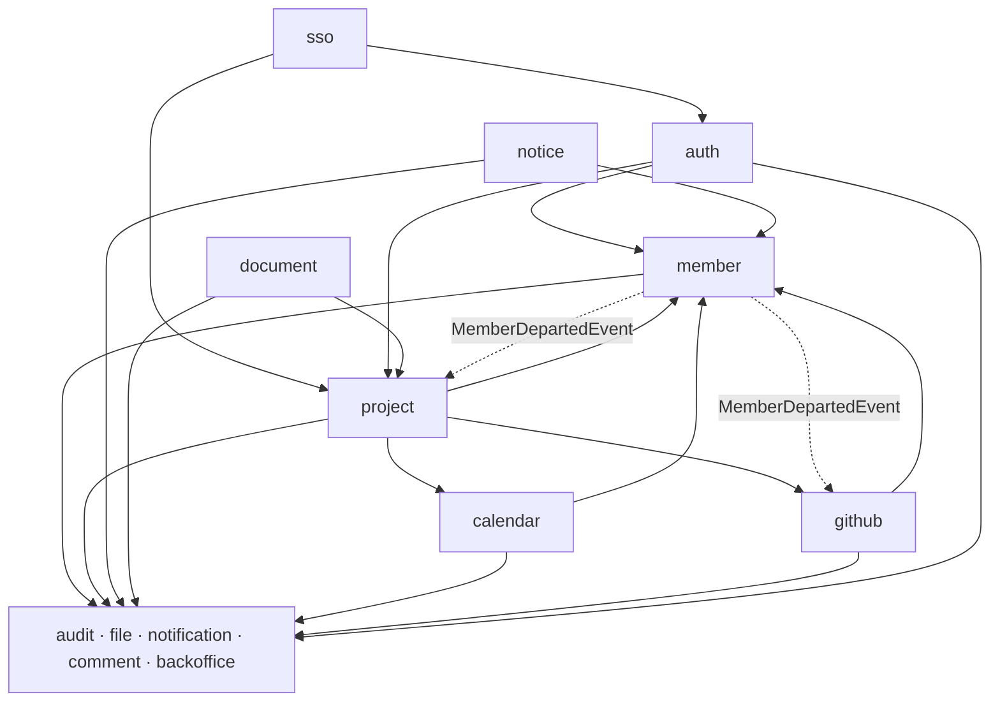

# API 명세

| 항목 | 내용 |
|------|------|
| 상태 | 초안 v0.1 (2026-11-18) |
| 근거 | [SRS](../srs/README.md), [테이블 설계](../db/README.md), Penpot `랩실` 파일의 화면 29개 (`02`~`05 Screens`), 기존 API(member · auth · backoffice · sso), defme_BE 컨트롤러 |
| 대상 | SRS 1차 범위 전체. 보류 기능(COM-6 등)은 빼고, 기존 API 는 바뀌는 것만 적음 |

이 문서는 공통 규칙, 영역별 문서 목록, 화면 ↔ API 대응, **테이블 설계와 맞춰 본 결과**를 정리합니다.
요청 · 응답의 모든 필드를 적지는 않고, 화면과 테이블을 이어 주는 데 필요한 필드와 규칙만 적습니다. 정확한 스키마는 구현할 때 Swagger(`XxxApiDocs`)가 기준입니다.

| 문서 | 모듈 | 내용 |
|------|------|------|
| [10-member.md](10-member.md) | member, auth, backoffice, sso | 내 프로필, 구성원 목록, 관리 · 구성원, 권한 프리셋, 가입 신청, 권한 신청, 졸업 처리 |
| [20-communication.md](20-communication.md) | notice, calendar, notification | 공지 · 투표, 캘린더, 모임 날짜 정하기, 알림 |
| [30-project.md](30-project.md) | project | 프로젝트, 참여자, 연동 서비스, 서비스 권한, 라벨, 마일스톤 |
| [31-task.md](31-task.md) | project | 작업 · 보드 · 체크리스트 · 구독 · 활동 기록, 프로젝트 스레드 |
| [32-minute-report.md](32-minute-report.md) | project | 회의록, 주간 보고 (+ GitHub 활동) |
| [40-document-file.md](40-document-file.md) | document, file | 자료실, 파일 올리기 · 내려받기 |
| [50-infra.md](50-infra.md) | audit, github | 감사 로그, GitHub 연결 · 조직 · 웹훅 |
| [60-common.md](60-common.md) | comment | 홈 대시보드 · 통합 검색이 부르는 API, 댓글 공통 규칙 |

---

## 1. 공통 규칙

기존 코드 규칙([code-convention](../code-convention.md))과 defme_BE 의 컨트롤러 방식을 따릅니다.

### 1.1 경로

| 규칙 | 예 | 출처 |
|------|----|------|
| `/api/v1/{도메인 복수형}`. 셀 수 없는 개념은 단수 | `/api/v1/notices`, `/api/v1/auth` | 기존 |
| 하위 자원은 경로로 잇는다 | `/api/v1/projects/{projectKey}/members` | defme |
| 상태를 바꾸는 동작은 `POST /{id}/{동사}` | `/members/{id}/disable`, `/tasks/{taskKey}/transition` | 기존 · defme |
| 일부 수정은 `PATCH`, 통째로 바꾸는 저장은 `PUT` | 회의록 저장은 `PUT` (버전 확인) | 기존 |
| 관리용 경로를 따로 두지 않는다 (`/admin/...` 없음). 같은 도메인 안에서 `@PreAuthorize` 로 나눈다 | `GET /api/v1/members` = `member-manage` | 기존 (defme 는 `/system-manager` 를 붙이지만 이 레포는 역할이 세분돼 있어 붙이지 않음) |
| 사람이 읽는 키가 있는 자원은 키로 가리킨다 | 프로젝트 `DEFME`, 작업 `DEFME-44` | SRS PRJ |
| 파일은 추측할 수 없는 `publicId`(UUID)로만 가리킨다 | `/api/v1/files/{publicId}/download` | DB `files.public_id` |
| 바깥(WARP 밖)에 여는 경로는 `/api` 아래에 두지 않는다 | `POST /webhooks/github` | NFR-SEC-10 |

### 1.2 인증 · 보안

- 로그인은 기존 세션 쿠키입니다. 바꾸는 요청(`POST/PUT/PATCH/DELETE`)은 `XSRF-TOKEN` 쿠키 값을 `X-XSRF-TOKEN` 헤더로 보냅니다 (기존).
- 권한 검사는 모두 서버에서 합니다 (NFR-SEC-02). 표의 "권한" 칸 표기:

  | 표기 | 뜻 |
  |------|----|
  | 로그인 | 로그인한 재실 구성원 누구나 |
  | 본인 | 그 자원의 주인 (내 프로필, 내 보고 등) |
  | `role-code` | 그 세부 역할 ([SRS 5.2](../srs/README.md#52-erp-세부-역할)) |
  | 작성자 | 그 글을 쓴 사람 |
  | 볼 수 있음 | 대상의 열람 권한 (비공개 프로젝트 · 참여자 전용 자료 등) |
  | PM | 그 프로젝트의 프로젝트 관리자 |
  | 참여자 | 그 프로젝트의 프로젝트 관리자 또는 참여자 |
  | 공개 | 로그인 없음 (공개 사이트 · 웹훅) |

- **볼 수 없는 대상은 403 이 아니라 404** 로 답합니다 (NFR-SEC-03). 볼 수는 있지만 바꿀 수 없으면 403 입니다.
- 목록 · 검색 · 대시보드 · 알림 · 파일 내려받기 모두 같은 열람 규칙을 씁니다.

### 1.3 응답

모든 API 는 기존 `ApiBaseResponse` 로 답합니다 (common-code).

```json
{ "success": true, "data": { "...": "..." }, "error": null }
```

```json
{ "success": false, "data": null,
  "error": { "status": 409, "code": "P012", "message": "다른 사람이 먼저 저장했어요.", "errors": null, "traceId": "..." } }
```

- 목록은 `PageResponse` 로 답합니다: `content`, `page`(0부터), `size`, `totalElements`, `totalPages`, `hasNext`.
  요청은 `page`(기본 0), `size`(기본 20, **최대 100**, NFR-PER-03), `sort`(`필드,asc|desc`).
- 목록 위에 따로 보이는 묶음(고정 글, 탭별 개수)은 `PageResponse` 와 나란히 담습니다.

  ```json
  { "pinned": [ ... ], "categoryCounts": { "PAPER": 34, "SLIDE": 27 }, "page": { "content": [ ... ], "page": 0, ... } }
  ```

- 만들기는 `201`, 나머지 성공은 `200`. 본문이 필요 없으면 `data: null`.
- 바꾼 뒤에는 바뀐 자원을 돌려줍니다 (화면이 다시 조회하지 않게).

### 1.4 값 형식

| 값 | 형식 | 비고 |
|----|------|------|
| 시각 | ISO-8601 UTC (`2026-11-17T00:12:00Z`) | 기존 응답(`Instant`)과 같다. 화면이 Asia/Seoul 로 바꿔 보여 준다 |
| 날짜 | `2026-11-17` | Asia/Seoul 기준 달력 날짜 (`~On` 필드) |
| 시간 | `14:00` | 모임 날짜 정하기의 하루 시작 · 끝 (KST) |
| enum | 이름 그대로 (`IN_PROGRESS`) | 테이블의 enum 이름과 같다 |
| 공통코드 값 | 상세 코드 (`DEV`, `PAPER`) | 표시 이름은 응답에 `~Name` 으로 같이 준다 |
| 구성원 표시 | `{ "memberId", "name", "memberType", "status", "photoUrl" }` | 졸업 · 퇴실이면 화면에 "졸업" 표시 (MEM-4-07). 이하 `MemberRef` |
| 작업 표시 | `{ "taskKey": "DEFME-44", "title", "status" }` | 이하 `TaskRef` |
| Markdown 본문 | 원문 문자열 | 서버는 HTML 로 바꾸지 않는다. 그리기 · Mermaid 는 브라우저 (CMN-3) |
| 첨부 | 요청은 `attachmentFileIds: [publicId]`, 응답은 `FileRef { publicId, name, size, contentType }` | 먼저 [파일 올리기](40-document-file.md#파일-올리기)로 올린 뒤 붙인다 |

### 1.5 동시 수정

여러 사람이 고치는 자원(작업, 회의록)은 요청에 `version` 을 넣습니다. 서버의 값과 다르면 **409** 로 거절하고 덮어쓰지 않습니다 (PRJ-3-05).
응답 `error.code` 로 구분하고, 화면은 최신 내용을 다시 불러와 "다른 사람이 먼저 저장했어요"를 보여 줍니다.

### 1.6 새로 고침 없는 반영 (NFR-PER-04)

WebSocket 은 쓰지 않고 **1분 이하 주기의 조회**로 맞춥니다.

| 화면 | 조회 | 가볍게 하는 방법 |
|------|------|------------------|
| 위 종 모양 | `GET /api/v1/notifications/unread-count` | 숫자 하나만 |
| 칸반 · 스레드 | 같은 목록 API 에 `since=<마지막 응답 시각>` | 그 뒤 바뀐 것만 돌려준다 |

### 1.7 공통 헤더

**요청**

| 헤더 | 언제 | 값 |
|------|------|----|
| `Cookie` | 로그인이 필요한 모든 API | `JSESSIONID=…` (세션), `XSRF-TOKEN=…` |
| `X-XSRF-TOKEN` | `POST` · `PUT` · `PATCH` · `DELETE` | `XSRF-TOKEN` 쿠키 값 그대로. 없거나 다르면 403 `C003` |
| `Content-Type` | 본문이 있을 때 | `application/json` (파일 본문은 Garage 로 직접 올리므로 ERP 에 multipart 요청 없음) |
| `Accept` | 선택 | `application/json` (CSV 내려받기만 `text/csv`) |

**응답**

| 헤더 | 언제 | 값 |
|------|------|----|
| `Content-Type` | 늘 | `application/json` (CSV · 리다이렉트 제외) |
| `Location` | `201` 만들기 | 만든 자원의 주소 (`/api/v1/notices/12`) |
| `Location` | `302` 내려받기 | 5분짜리 서명 주소 |
| `Cache-Control` | 늘 | `no-store` (개인 정보가 담김) |
| `Set-Cookie` | 로그인 · 로그아웃 · CSRF 갱신 | 기존 그대로 |

각 API 의 "요청 헤더"에는 **위 공통 헤더 말고 더 필요한 것**만 적습니다. 적힌 것이 없으면 공통 헤더만 씁니다.

### 1.8 공통 에러 코드

모든 API 에서 나올 수 있어 API 마다 다시 적지 않습니다 (common-code `CommonErrorCode`).

| HTTP | 코드 | 언제 |
|------|------|------|
| 400 | `C001` | 입력 검증 실패 (`@Valid`). `error.errors[]` 에 `{ field, reason }` |
| 401 | `C002` | 로그인 안 함 · 세션 만료 |
| 403 | `C003` | 권한 없음, CSRF 토큰 없음 · 틀림 |
| 403 | `A001` | 임시 비밀번호로 로그인한 상태 (비밀번호 변경 전) — 기존 |
| 404 | `C004` | 경로가 없음. **볼 수 없는 대상도 모듈의 `…_NOT_FOUND` 404** 로 답한다 |
| 405 | `C005` | 메서드가 틀림 |
| 409 | `C006` | 그 밖의 충돌 |
| 413 | `C008` | 본문이 너무 큼 |
| 415 | `C009` | `Content-Type` 이 JSON 이 아님 |
| 502 | `C010` | 외부 서비스(GitHub · Jenkins · Vault · Penpot · Garage) 호출 실패. 상태 조회 API 는 502 대신 `"status": "UNAVAILABLE"` 로 답한다 (NFR-PER-05) |

### 1.9 에러 코드 접두사 · 번호

기존 `C`(공통) · `A`(auth, `A001`) · `B`(backoffice, `B001~B009`) · `M`(member, `M001~M010`) · `S`(sso, `S001~S002`) 다음 번호부터 씁니다.

| 접두사 | 모듈 | 번호 범위 | 문서 |
|--------|------|-----------|------|
| `M` | member | `M011~` | [10](10-member.md) |
| `A` | auth (권한 신청) | `A002~` | [10](10-member.md) |
| `B`, `S` | backoffice, sso | 기존 다음 번호 | [10](10-member.md) |
| `N` | notice | `N001~` | [20](20-communication.md) |
| `CL` | calendar | `CL001~` | [20](20-communication.md) |
| `NT` | notification | `NT001~` | [20](20-communication.md) |
| `P` | project | `P001~P099` 프로젝트 · 서비스 권한 · 라벨 · 마일스톤, `P100~P199` 작업 · 스레드, `P200~P299` 회의록 · 주간 보고 | [30](30-project.md), [31](31-task.md), [32](32-minute-report.md) |
| `D` | document | `D001~` | [40](40-document-file.md) |
| `F` | file | `F001~` | [40](40-document-file.md) |
| `AU` | audit | `AU001~` | [50](50-infra.md) |
| `G` | github | `G001~` | [50](50-infra.md) |
| `CM` | comment | `CM001~` | [60](60-common.md) |

각 문서 끝에 그 모듈의 **에러 코드 표**(HTTP · 코드 · 이름 · 메시지)를 둡니다. 이름은 enum 상수 이름 그대로입니다 (`NOTICE_NOT_FOUND`).

### 1.10 API 하나를 적는 형식

영역 문서는 맨 위에 **API 목록 표**를 두고, 그 아래 API 마다 다음 형식으로 적습니다.

````markdown
### N-1. 공지 쓰기

`POST /api/v1/notices`

| 항목 | 내용 |
|------|------|
| 권한 | `notice-write` |
| 요구사항 | COM-1-01, COM-1-09 |
| 테이블 | `notices`, `polls`, `poll_options`, `files` |
| 감사 로그 · 알림 | 필독이면 `NOTICE_MUST_READ` 알림 |

**요청 헤더** — 공통

**경로 · 쿼리 파라미터** — 없음  (있으면 표: 이름 · 타입 · 필수 · 설명)

**요청 본문**

| 필드 | 타입 | 필수 | 규칙 · 설명 |
|------|------|------|-------------|
| `title` | string | O | 1~100자 |

```json
{ "title": "…" }
```

**응답** `201 Created` (`Location: /api/v1/notices/12`)

| 필드 | 타입 | 설명 |
|------|------|------|
| `noticeId` | number | |

```json
{ "success": true, "data": { "noticeId": 12 }, "error": null }
```

**에러**

| HTTP | 코드 | 언제 |
|------|------|------|
| 409 | `N003` | 상단 고정이 이미 3개 |
````

- 공통 에러(1.8)는 표에 다시 적지 않습니다.
- 같은 모양이 반복되는 응답(`MemberRef`, `TaskRef`, `FileRef`, `PageResponse`)은 이름만 쓰고, 각 문서 처음의 "공통 모양"에 한 번 적습니다.

### 1.11 API 를 늘리지 않는 규칙

화면마다 API 를 만들지 않습니다. 백엔드는 같은 데이터를 같은 API 로 주고, 화면이 거르거나 가공해 씁니다.

| # | 규칙 | 예 |
|---|------|----|
| 1 | **같은 데이터면 같은 API.** 보기 방식만 다른 것(월 · 주 · 목록, 탭, 겹쳐 그리기, 묶어 보기)은 화면이 가공한다. 화면 하나만을 위한 API 를 만들지 않는다 | 모임 날짜의 "내 개인 일정 겹쳐 보기"는 `GET /calendar-events` 를 그대로 씀. 졸업생 연도별 묶음은 화면이 묶음 |
| 2 | **상태 바꾸기는 `PATCH` 나 결정 하나로.** 켜기 · 끄기, 고정 · 해제, 열기 · 닫기는 `PATCH` 의 필드, 승인 · 거절은 `POST /{id}/review { decision }` 하나. 동작 경로(`POST /{id}/동사`)는 부수 효과가 큰 것(졸업 처리, 작업 상태 이동, 모임 확정, 계정 조치)만 | `PATCH /role-presets/{id} { enabled: false }`, `POST /auth/access-requests/{id}/review { decision: "REJECT", reason }` |
| 3 | **여러 곳에서 쓰는 기능은 공통 API 하나.** 대상 종류 · ID 를 파라미터로 받고 권한은 대상 모듈의 정책(`CommentTargetPolicy`, `FileTargetPolicy`)이 판단 | 댓글은 `/comments?targetType=TASK&targetId=` 하나 (공지 · 작업 · 스레드 · 주간 보고 · 자료 모두) |
| 4 | **권한에 따라 다른 내용은 API 를 나누지 않고 필드를 뺀다.** 볼 권한이 없는 값은 화면에서 숨기는 것이 아니라 **응답에 넣지 않는다** (개발자 도구로 보이므로) | 익명 투표의 투표자, 비공개 연락처, "바쁨" 일정의 원래 제목, 필독 공지의 안 읽은 사람 명단(작성자 · `content-manage` 만) |

목록은 그래도 페이지로 나눕니다 (한 번에 최대 100개, NFR-PER-03). "전부 주고 화면이 거르기"는 페이지 안에서만 합니다.

### 1.12 여러 영역이 같이 쓰는 API

| 기능 | API | 문서 |
|------|-----|------|
| 댓글 | `GET /comments?targetType=&targetId=`, `POST /comments`, `PATCH /comments/{commentId}`, `DELETE /comments/{commentId}`. `targetType` = `NOTICE`, `TASK`, `PROJECT_THREAD`, `WEEKLY_REPORT`, `DOCUMENT`, `targetId` = 대상의 숫자 ID | [60](60-common.md) |
| 파일 | `POST /files/uploads` → Garage 로 직접 올림 → `POST /files/uploads/{publicId}/complete`, `GET /files/{publicId}/download`, `DELETE /files/{publicId}`. 글에 붙이는 것은 각 글의 만들기 · 고치기 본문의 `attachmentFileIds` | [40](40-document-file.md) |
| 승인 · 거절 | `POST /{자원}/{id}/review` — `{ "decision": "APPROVE" \| "REJECT", "reason": "…" }` + 자원별 승인 값 | 가입 신청 · 권한 신청 · Vault 경로 묶기 |
| 홈 | **API 없음.** 화면이 각 모듈 API 를 동시에 불러 칸마다 그린다. 한 칸이 실패해도 나머지는 보인다 (CMN-1-03) | [60](60-common.md) |
| 통합 검색 | **API 없음.** 화면이 각 목록 API 를 `keyword` 로 동시에 불러 종류별로 묶는다 | [60](60-common.md) |
| 작업 번호 링크 | `GET /tasks/lookup?keys=DEFME-12,DEFME-13` — 볼 수 있는 것만 돌려줌 (PRJ-2-03, Markdown 링크) | [31](31-task.md) |
| @멘션 후보 | `GET /members?keyword=` 를 그대로 쓰고, 프로젝트 안에서는 `GET /projects/{key}` 의 참여자 목록을 쓴다. 서버는 저장할 때 멘션 대상이 그 글을 볼 수 있는지 다시 확인한다 (PRJ-2-52) | [10](10-member.md), [30](30-project.md) |

---

## 2. 화면 ↔ API

Penpot `랩실` 파일의 화면 29개가 쓰는 API 입니다. 화면 이름은 Penpot 보드 이름 그대로입니다.

| 화면 | 주로 쓰는 API |
|------|---------------|
| 02 · 홈 | `GET /notices`, `GET /meeting-polls`, `GET /weekly-reports/me/{weekStartOn}`, `GET /calendar-events`, `GET /tasks?mine=true`, `GET /tasks?awaitingMyReview=true`, `GET /projects?mine=true`, `GET /sso/apps` ([60](60-common.md)) |
| 02 · 공지 상세 | `GET /notices/{noticeId}` (투표 · 결과 · 읽음 숫자 · 명단 포함), `PUT /notices/{noticeId}/poll/my-vote`, `GET·POST /comments?targetType=NOTICE` |
| 02 · 캘린더 | `GET /calendar-events`, `GET /tasks?mine=true&dueFrom=&dueTo=`, `GET /milestones`, `GET·PUT /calendar-settings/me`, `POST /meeting-minutes` (일정 값으로 채움) |
| 02 · 모임 날짜 정하기 | `GET /meeting-polls/{pollId}`, `PUT /meeting-polls/{pollId}/my-response`, `GET /calendar-events` (내 개인 일정 겹치기), `POST /meeting-polls/{pollId}/remind`, `POST /meeting-polls/{pollId}/confirm` |
| 02 · 자료실 | `GET /documents` (고정 · 카테고리 개수 · 해결 안 된 질문 필터 포함), `GET /documents/tags` |
| 02 · 구성원 | `GET /members`, `GET /members/{memberId}`, `GET /projects?memberId=`, `GET /github/accounts/{memberId}` |
| 03 · 프로젝트 목록 | `GET /projects` (카테고리 개수 포함) |
| 03 · 프로젝트 홈 | `GET /projects/{projectKey}`, `GET /projects/{projectKey}/links`, `GET /projects/{projectKey}/links/status`, `GET /projects/{projectKey}/activities`, `GET /milestones?projectKey=`, `GET /tasks?projectKey=&dueFrom=`, `GET /calendar-events?projectId=`, `GET /projects/{projectKey}/service-access` |
| 03 · 칸반 보드 | `GET /tasks?projectKey=&doneWithinDays=14&sort=board`, `POST /tasks/{taskKey}/transition`, `PATCH /tasks/{taskKey}` (`boardPosition`) |
| 03 · 프로젝트 스레드 | `GET /projects/{projectKey}/threads`, `PATCH /projects/{projectKey}/threads/{threadId}` (고정 · 해제), `PUT /projects/{projectKey}/threads/pinned-order`, `GET·POST /comments?targetType=PROJECT_THREAD` |
| 03 · 스레드 글쓰기 | `POST /projects/{projectKey}/threads`, `GET /projects/{projectKey}` (멘션 후보 = 참여자), `GET /tasks/lookup`, `POST /files/uploads` |
| 03 · 작업 상세 | `GET·PATCH /tasks/{taskKey}`, `/tasks/{taskKey}/checklist-items`, `PUT·DELETE /tasks/{taskKey}/watch`, `GET /projects/{projectKey}/activities?taskKey=`, `GET·POST /comments?targetType=TASK` |
| 03 · 회의록 | `GET·PUT /meeting-minutes/{minuteId}`, `GET /meeting-minutes/{minuteId}/revisions`, `POST /meeting-minutes/{minuteId}/actions/convert-to-tasks` |
| 03 · 주간 보고 | `GET·PUT /weekly-reports/me/{weekStartOn}`, `PATCH /weekly-reports/{reportId}` (제출 · 확인), `GET /weekly-reports?weekStartOn=`, `GET /weekly-reports/github-activity`, `POST /weekly-reports/github-activity/refresh`, `GET·POST /comments?targetType=WEEKLY_REPORT` |
| 03 · 프로젝트 설정 · 서비스 권한 | `GET /projects/{projectKey}/service-access`, `PATCH /projects/{projectKey}/service-access/{service}`, `PUT /projects/{projectKey}/service-access/members`, `POST /projects/{projectKey}/service-access/{service}/sync`, `POST /projects/{projectKey}/vault-path-requests` |
| 04 · 관리 · 구성원 | `GET /members` (탭 숫자 · 관리 칸 포함), `GET·PATCH /members/{memberId}`, `PUT /members/{memberId}/roles`, `POST /members/{memberId}/preset-applications`, 계정 조치 `POST /members/{memberId}/disable` 등 |
| 04 · 관리 · 졸업 처리 | `GET /members/{memberId}`, `GET /projects/handover?memberId=`, `GET /github/accounts/{memberId}`, `POST /members/{memberId}/departures` |
| 04 · 관리 · 권한 프리셋 | `GET·POST /role-presets`, `PATCH /role-presets/{presetId}` (반영 미리보기 · 사용 안 함 포함) |
| 04 · 관리 · 가입 신청 | `GET /signup-applications`, `GET /members/identifier-check`, `POST /signup-applications/{applicationId}/review` |
| 04 · 관리 · 권한 신청 | `GET /auth/access-requests?scope=REVIEW`, `POST /auth/access-requests/{requestId}/review` |
| 04 · 관리 · 감사 로그 | `GET /audit-logs`, `GET /audit-logs/export` |
| 04 · 관리 · 공통코드 | 기존 `/backoffice/common-codes/*`, `POST /sso/clients/{clientId}/secret` |
| 04 · 관리 · GitHub | `GET /github/accounts`, `GET /github/webhook-deliveries`, `POST /github/link-reminders`, `POST /github/org-sync` |
| 05 · 로그인 · 안내 상태 · 비밀번호 변경 | 기존 (`/login` 화면, `PATCH /auth/password`) |
| 05 · 가입 신청 (공개 사이트) | `POST /public/v1/signup-applications` (전달 방식 미정) |
| 05 · 내 프로필 | `GET·PATCH /members/me`, `PUT·DELETE /members/{memberId}/photo`, `GET /auth/service-access/me`, `GET·DELETE /github/accounts/{memberId}`, `GET /github/link/start`, `GET·PUT /notifications/settings` |
| 05 · 알림 | `GET /notifications`, `GET /notifications/unread-count`, `POST /notifications/read` |

**화면이 없는 API**: 공지 목록 · 쓰기, 프로젝트 만들기 · 설정(일반 · 참여자 · 라벨 · 연동 서비스 · 보관), 작업 목록 · 내 작업 · 마일스톤, 회의록 목록, 자료 쓰기 · 상세, 통합 검색 결과, 파일 사용량, 지운 자료 되살리기, Vault 경로 묶기 승인, 서비스 권한 불일치, 주기 작업 실패는 화면이 아직 없습니다. API 는 SRS 기준으로 적었고, 화면을 그릴 때 다시 맞춥니다 (아래 3.4).

---

## 3. 테이블 설계와 맞춰 본 결과

SRS · 화면 → API → 테이블 순서로 따라가며 맞지 않는 곳을 찾았습니다. **결정이 필요한 것**과 **문서만 고치면 되는 것**으로 나눴습니다.

### 3.1 모듈 의존이 순환함 → 이벤트 · 인터페이스로 푼다 (결정)

테이블 설계 [1.2 의존 방향](../db/README.md#12-새-모듈과-의존-방향)대로 만들면 아래 기능이 반대 방향 호출을 필요로 합니다. Gradle · ArchUnit 이 빌드를 막습니다.

| # | 기능 | 문제 | 결정 |
|---|------|------|------|
| R1 | 권한 신청 승인 (INF-1) | `access_requests` 는 member 모듈인데, 프로젝트 권한 신청은 승인자(PM) 판단과 승인 결과 쓰기(`project_member_service_levels`)가 project 모듈에 있다. **member → project** 가 되어 `project → member` 와 순환 | **`access_requests` 를 auth 로 옮긴다.** auth 가 연구실 역할은 `MemberCommandApi`, 프로젝트 서비스 수준 · PM 확인은 project 공개 API 로 다룬다. project 는 auth 를 모르므로 순환 없음. 내 서비스 권한(`/auth/service-access/me`)도 auth |
| R2 | 졸업 · 퇴실 처리 (MEM-4) | 확인 화면(참여 프로젝트, 끝나지 않은 담당 작업)과 처리(이전 참여자로 바꾸기, 작업 넘기기, GitHub 조직 제거)가 project · github 를 불러야 한다. member 는 그 모듈을 모른다 | **member 에 그대로 둔다.** member 가 같은 트랜잭션 안에서 `MemberDepartedEvent` 를 내고 project 가 `@EventListener` 로 받아 이전 참여자 · 작업 · PM 을 처리한다 (실패하면 전체 롤백, MEM-4-04). GitHub 조직 제거는 `AFTER_COMMIT` 로 받는다. 확인 화면은 project 의 `GET /projects/handover` 를 화면이 부른다 |
| R3 | 캘린더의 작업 기한 · 마일스톤 표시 (COM-4-09), 프로젝트 참여자로 모임 대상 채우기 (COM-3-09), 프로젝트로 일정 거르기 (COM-4-07) | calendar 가 project 를 읽어야 하는데 테이블 설계는 `project → calendar` (회의록이 일정을 읽음) | calendar 는 project 를 모르게 둔다. 비공개 프로젝트 일정의 열람 판단은 calendar 에 인터페이스를 두고 project 가 구현한다. 작업 기한은 `GET /tasks`, 마일스톤은 `GET /milestones` 를 화면이 따로 불러 겹친다. 프로젝트 모임은 `POST /projects/{key}/meeting-polls` 가 참여자를 펼쳐 calendar API 를 부른다 |
| R4 | 감사 로그 화면 (INF-2) | 한 목록에 `audit_logs`(audit)와 `login_histories`(auth)를 시간순으로 섞어 페이지를 나눠야 한다. audit 는 의존이 없는 모듈이라 auth 를 못 읽고, 두 모듈 표를 섞은 페이지 계산도 어렵다 | **로그인 성공 · 실패도 `audit_logs` 에 한 줄 남긴다** (`category = LOGIN`). `login_histories` 는 잠금 판단용으로 그대로 둔다. 1년 보관도 같아진다 (INF-2-06) |
| R5 | 파일 내려받기 권한 (DOC-2-04) | 파일 권한은 붙은 글의 권한을 따르는데 file 은 의존이 없는 모듈이다 | comment 의 `CommentTargetPolicy` 와 같은 방식으로 file 공개 API 에 **`FileTargetPolicy`** 를 두고 대상 모듈이 구현한다 (테이블 변화 없음, 문서에 적기만) |
| R6 | 홈 대시보드 · 통합 검색 (CMN-1, CMN-2) | 모든 모듈을 모아야 하는데 맡을 모듈이 없다 | **모듈 · API 를 두지 않는다.** 화면이 각 모듈 API 를 함께 부른다. 서비스 바로 가기는 기존 `GET /sso/apps`. 검색에 모자란 두 곳만 목록 API 에 더함: 여러 프로젝트 스레드 검색(`GET /projects/threads`), 댓글 `keyword` |
| R7 | OIDC `groups` 의 `prj-` 그룹, `SSO_APP` 의 `@project` (PRJ-1-51) | sso 가 project 를 읽는다. 의존 표에 없음 | 의존 표에 `sso → project`, `auth → project` 를 더한다 (순환은 아님) |

결정을 반영한 의존 방향입니다 (점선 = 이벤트 · 인터페이스로 아래 모듈이 위 모듈에 알림).



### 3.2 테이블 · 컬럼 보완

| # | 테이블 | 내용 | 근거 | 제안 |
|---|--------|------|------|------|
| T1 | `files` | SRS 는 메타데이터에 **해시**를 저장한다고 했는데 칸이 없다 | DOC-2-01 | `sha256 char(64)` 추가 (무결성 확인용. 중복 제거는 안 함, Q16). 또는 SRS 에서 "해시"를 뺀다 |
| T2 | `files` | 200MB 를 나눠 올리려면(DOC-2-07) 브라우저가 Garage 로 직접 올리고 완료를 알려야 한다. 올리는 중인 상태 · Garage `uploadId` 를 둘 칸이 없다 | DOC-2-07 | `status varchar(30)` (FileStatus: `UPLOADING`, `READY`), `upload_id varchar(255)` 추가. ERP 가 받아서 넘기는(프록시) 방식이면 필요 없음 — [40 문서](40-document-file.md#파일-올리기)에서 직접 올리기를 제안 |
| T3 | `document_files` | 자료실 목록의 "파일 형식" 거르기 · 카드의 `DOCX` 표시를 하려면 file 모듈 표를 조인해야 한다 (다른 모듈 표 직접 조회 금지) | DOC-1-03, 자료실 화면 | `file_extension varchar(20)`, `file_size bigint` 를 붙일 때 복사해 둔다 |
| T4 | `project_threads` | 화면에 "11/14 **김서연** 수정"이 보인다. 고친 사람을 감사 컬럼(로그인 ID)으로만 알 수 있다. 공통 규칙은 "화면에 이름을 보여 주는 '누가'는 `~_member_id`" | 스레드 화면, DB 1장 | `edited_by_member_id bigint` 추가 |
| T5 | `tasks` | 홈 "검토를 기다리는 작업"(내가 요청자인 검토 작업)에 맞는 인덱스가 없다 | CMN-1-06 | `idx_tasks_requester (requester_member_id, status)` |
| T6 | `notifications.type` | 알림 종류가 빠졌다: 스레드 답글(작성자), 주간 보고 "확인", GitHub 연결 요청(관리 · GitHub 화면 "알림 보내기"), GitHub 연결 해제(`github-manage` 에게), 주기 작업 실패, Vault 경로 묶기 신청(`sso-admin` 에게), 일정 취소 | PRJ-2-74, COM-5 표, INF-3-03, NFR-OPS-05, PRJ-1-42 | `THREAD_REPLY`, `REPORT_CONFIRMED`, `GITHUB_LINK_REQUEST`, `GITHUB_UNLINKED`, `JOB_FAILED`, `VAULT_PATH_REQUEST`, `EVENT_CANCELLED` 추가 (**반영함**, notification 모듈) |
| T7 | `calendar_event_exceptions` | "이 일정만" 고칠 때 바꿀 수 있는 값에 온라인 링크 · 설명이 없다 | COM-4-08 | `online_url`, `description` 추가 (또는 "이 일정만"은 제목 · 시각 · 장소만 바꾼다고 SRS 에 적기) |
| T8 | `members.student_number` | 기존 생성 API 가 숫자만 받는다(`^[0-9]{1,20}$`). 인턴 `I2026001`, 관리 화면의 교수 `P2019001` 이 들어가지 않는다 | MEM-1, 관리 · 구성원 화면 | 형식 검사를 영문 대문자 + 숫자로 넓힌다 (테이블은 `varchar(20)` 그대로). 교번 형식을 SRS 에 적는다 |
| T9 | `comments` | 60-common 의 API 경로 예시가 `/api/tasks/{key}/comments` (버전 빠짐) | 공통 규칙 | `/api/v1/tasks/{taskKey}/comments` — 이번에 고침 |

### 3.3 화면 ↔ SRS · 테이블 불일치

| # | 화면 | 내용 | 제안 |
|---|------|------|------|
| S1 | 작업 상세 | "연결"에 **PR #131 (GitHub · 열림)**, **Jenkins #141 (성공)** 이 보인다. SRS 에 작업 ↔ PR · 빌드 연결 요구사항이 없고, PR 은 저장하는 표도 없다 (`github_commits` 만 있음) | (a) 화면에서 뺀다, 또는 (b) 요구사항을 더한다: 커밋 메시지 · 브랜치 이름에 작업 키가 있으면 그 커밋을 보여 준다(있는 표로 가능). PR · 빌드는 저장하지 않고 조회 때 GitHub · Jenkins 에서 가져온다(5분 캐시) |
| S2 | 프로젝트 스레드 | "글쓴이와 **지켜보는 사람**에게 알림"이라고 적혀 있는데, SRS 는 작성자만(PRJ-2-74) 알림을 받고 스레드 구독 표가 없다 | 화면 문구를 "글쓴이와 멘션된 사람에게 알림"으로 고친다. 스레드 구독이 필요하면 `project_thread_watchers` 를 더한다 |
| S3 | 관리 · 졸업 처리 | 졸업하는 사람이 **마지막 프로젝트 관리자**인 경우가 화면 예시(DEFME 프로젝트 관리자)에 있다. PRJ-1-04 는 마지막 PM 을 뺄 수 없다고 하고, MEM-4 는 이 경우를 정하지 않았다 | 처리 화면에서 그 프로젝트의 새 PM 을 고르게 한다 (고르지 않으면 처리 불가). SRS MEM-4 에 규칙을 더한다 |
| S4 | 홈 | 필독 공지 카드에 "8명 확인 / 3명 미확인"이 모든 사람에게 보인다. COM-1-05 는 읽음 · 안 읽음 **명단**을 작성자 · `content-manage` 만 본다고 했다 | 숫자는 모두에게, 명단은 작성자 · `content-manage` 만 (API 를 이렇게 나눔). SRS 에 "숫자는 공개"를 적는다 |
| S5 | 가입 신청 (공개 사이트) | 희망 로그인 ID 옆에 "사용 가능"이 보인다. 공개 사이트에서 ID 사용 여부를 알려 주면 바깥에서 **연구실 계정 ID 를 알아낼 수 있다** | 공개 사이트에서는 확인하지 않는다. 승인할 때 관리자가 확인한다 (MEM-3-06 이 이미 그 경우를 다룸) |
| S6 | 관리 · 감사 로그 | 예시 값 `FILE_POLICY / MAX_SIZE` 는 테이블 설계의 상세 코드(`MAX_ATTACHMENT_MB`)와 다르다 | 화면 예시 문구만 고친다 |
| S7 | 프로젝트 설정 | 탭(일반 · 참여자 · 라벨 · 연동 서비스 · 서비스 권한 · 보관 · 삭제)에 **권한 신청**이 없다. INF-1-04 는 PM 이 프로젝트 설정 화면에서 신청을 본다고 했다 | 설정에 "권한 신청" 탭을 더한다 (API 는 `GET /auth/access-requests?scope=REVIEW&projectKey=`) |

### 3.4 화면이 없는 기능

SRS 에 있고 API 도 적었지만 Penpot 에 화면이 없습니다. 화면을 그리거나 기존 화면에 넣을 곳을 정해야 합니다.

| 기능 | SRS | 권한 | 넣을 곳 제안 |
|------|-----|------|-------------|
| Vault 경로 묶기 승인 | PRJ-1-42 | `sso-admin` | 관리 · 권한 신청 화면에 탭 추가 |
| 서비스 권한 불일치 목록 | PRJ-1-46 | (SRS 에 없음 → `sso-admin` 제안) | 관리 · 공통코드 옆 "연동 상태" |
| 주기 작업 실행 기록 · 실패 | NFR-OPS-05 | (SRS 에 없음 → `code-manage` 제안) | 관리 · 연동 상태 |
| 지운 자료 되살리기 | DOC-1-10 | `content-manage` | 자료실 "지운 자료" 필터 |
| 파일 사용량 | DOC-2-10 | `file-manage` | 관리 화면 탭 |
| 공지 목록 · 쓰기, 프로젝트 만들기 · 설정 나머지 탭, 작업 목록 · 내 작업 · 마일스톤, 회의록 목록, 자료 쓰기 · 상세, 검색 결과 | 각 기능 | | 디자인 추가 |

### 3.5 맞는 것으로 확인한 것

화면에 보이는 값은 위 항목을 빼면 모두 테이블에서 나옵니다. 특히 다음은 화면 · SRS · 테이블이 정확히 맞습니다.

- 익명 투표: 결과 API 에 투표자 ID 가 없고(`poll_options.anonymous_vote_count`), 참여 여부만 날짜까지(`poll_participants.voted_on`)
- 칸반: 완료 열 14일(`tasks.completed_at`), 담당자 없는 "진행 중" 이동 거절, 문자열 순위(`board_rank`)
- 회의록: 동시 저장 거절(`version`), 수정 이력 보기(`meeting_minute_revisions.snapshot`), 할 일 → 작업(`meeting_minute_actions.task_id`)
- 주간 보고: 제출 · 늦은 제출 · 미제출, 확인 뒤 수정 불가, GitHub 브랜치별 · 중복 없는 줄 수(`github_commit_branches`)
- 프로젝트 서비스 권한: 역할별 기본값 · 구성원별 개별값 · 기한(`project_member_service_levels`), Vault 경로 · Jenkins 작업 여러 개(`project_service_resources`), 프로비저닝 결과 · 다시 시도(`project_service_settings`, `project_service_sync_jobs`)
- 권한 신청: 대기 · 승인 · 거절 · 만료, 기한 3일 전 알림(`access_requests.expire_notified_at`)
- 프리셋: 기본 구분, 사용 안 함, 적용한 구성원 수 · 반영 대상(`member_preset_applications`)
- GitHub 관리: 조직 소속 · 초대 대기 · 제거 실패(`member_github_accounts.org_status`), 웹훅 서명 불일치 기록(`github_webhook_deliveries`)

### 3.6 명세를 쓰며 새로 찾은 것

API 를 하나씩 적으면서 나온 것입니다. 자세한 내용은 각 문서 끝에 있습니다.

**테이블 · 컬럼**

| # | 테이블 | 내용 | 제안 | 문서 |
|---|--------|------|------|------|
| T10 | `tasks` | 만든 사람 ID 가 없어 "자기가 만든 작업만 지우기"를 감사 컬럼(로그인 ID)으로만 판단 | `creator_member_id bigint` | [31](31-task.md) |
| T11 | `tasks` | 카드를 끌기만 해도(`board_rank`) `version` 이 올라 그 작업을 고치던 사람이 409 | `board_rank` 는 낙관적 잠금에서 뺌 (`@OptimisticLock(excluded = true)`, 테이블 변경 없음) | [31](31-task.md) |
| T12 | `github_repositories` | `github_repo_id` · `default_branch` 가 NOT NULL 이라 App 이 설치되지 않은 저장소는 연결 자체가 안 됨 (INF-3-07 은 "알려 준다") | 두 칸을 NULL 허용, 설치되면 채움. 지금 명세는 연결을 거절(`P017`) | [30](30-project.md) |
| T13 | `project_vault_path_requests` | 묶은 경로를 풀 방법이 없음 | 상태 `REVOKED` 추가. 풀면 `project_service_resources` 의 `APPROVED` 행을 지운다 | [30](30-project.md) |
| T14 | `projects` | 보관을 풀 때 돌아갈 상태가 없음 | 명세는 풀 때 상태를 고르게 함. 또는 `status_before_archive` | [30](30-project.md) |
| T15 | `github_webhook_deliveries` | 관리 화면의 "defme_BE · feature/oidc-logout · 커밋 2" 를 보여 줄 칸이 없음 | `summary varchar(200)` | [50](50-infra.md) |
| T16 | `members.name` | SRS 1~30자, 테이블 · 기존 DTO 50자 | 명세는 SRS(30자)를 따름. 하나로 맞춘다 | [10](10-member.md) |
| T17 | `notices.pinned_until` | SRS 는 날짜, 테이블은 시각 | API 는 날짜로 받고 그날 끝(KST)으로 저장 | [20](20-communication.md) |

**권한 · 공개 범위 (SRS 에 규칙이 없거나 서로 다름)**

| # | 내용 | 명세의 제안 | 문서 |
|---|------|-------------|------|
| A1 | 회의록 양식 · 카테고리 · 일정 종류 드롭다운은 누구나 읽어야 하는데 공통코드 조회는 관리 권한 | 로그인 읽기 전용 공통코드 조회(그룹 지정)를 둔다 | [32](32-minute-report.md) |
| A2 | 주간 보고는 모두가 보는데 작업 연동 · GitHub 활동에 **비공개 프로젝트**의 작업 제목 · 저장소 · 커밋 메시지가 들어감 (PRJ-4-27 과 충돌) | 볼 수 없는 프로젝트 것은 개수만 | [32](32-minute-report.md) |
| A3 | 연구실 회의록(프로젝트 없음)을 지울 사람이 없음 (PM 이 없음) | 작성자 · `project-manage`. `content-manage` 로 할지 결정 필요 | [32](32-minute-report.md) |
| A4 | 스레드 글을 지울 사람, 고정 순서를 바꿀 사람(PRJ-2-73a "고정한 사람" vs 권한 표 "PM · `project-manage`")이 다름 | 작성자 · PM 급이 지움, 순서는 권한 표를 따름 | [31](31-task.md) |
| A5 | 마감 전 투표 결과를 누가 보는지 | 대상이 아니면 못 봄, 작성자 · `content-manage` 는 숫자만 | [20](20-communication.md) |
| A6 | 공개 신청에서 이미 있는 **학번**이면 거절(MEM-3)하는 것도 S5 와 같은 문제 (바깥에서 학번 존재 확인 가능) | 접수는 받고 승인 때 관리자가 정리 | [10](10-member.md) |
| A7 | 홈 "서비스 바로 가기"는 SRS 는 권한 있는 것만, 화면은 "권한 없음" 카드 · `SSO_APP` 에 없는 GitHub 카드도 보임 | 모두 주고 `accessible` 로 구분 | [60](60-common.md) |
| A8 | `GET /members` · `/members/{id}` 를 구성원 화면과 함께 쓰려고 로그인한 누구나로 넓힘 | 관리 칸은 권한별로 응답에서 뺌. `/admin/members.html` 은 이에 맞춰 고침 | [10](10-member.md) |
| A9 | 서비스 권한 불일치(PRJ-1-46) · 주기 작업 기록(NFR-OPS-05)을 볼 역할이 없음 | `sso-admin` · `code-manage` | [30](30-project.md), [10](10-member.md) |
| A10 | `LAB` 프로젝트 보관 · 삭제, 지운 프로젝트 키 재사용 | 둘 다 금지 (`P035`, `P002`) | [30](30-project.md) |

**동작 · 운영**

| # | 내용 | 명세의 제안 | 문서 |
|---|------|-------------|------|
| O1 | Garage 는 바깥에 공개하지 않는데(NFR-ENV-03) 서명 주소로 올리고 받으려면 브라우저가 Garage 에 닿아야 함 | WARP 안 nginx 경로(`lab.iturtle.win/storage/`)로만 연다. 안 되면 ERP 가 받아서 넘기는 방식으로 바꿈 (그때는 T2 불필요) | [40](40-document-file.md) |
| O2 | 본문에 붙여넣은 이미지를 글에 붙이는 방법 | 서버가 본문에서 `/api/v1/files/{publicId}/download` 주소를 찾아 그 글에 붙임 (모든 Markdown 글 공통) | [20](20-communication.md) |
| O3 | 알림의 보낸 사람 이름 · 사진: notification 은 member 를 모름 | 응답은 `actorMemberId` 만, 화면이 구성원 조회로 채움 | [20](20-communication.md) |
| O4 | 보드 `since` 는 `tasks.updated_at` 기준이라 댓글 수 · 체크리스트 진행이 1분 반영에서 빠짐 | 댓글 · 체크리스트가 바뀌면 작업 `updated_at` 도 갱신 | [31](31-task.md) |
| O5 | 미제출 계산이 지금 역할 · 상태 기준이라 지난 주 현황이 바뀜 | `joined_on` · `left_on` 으로 범위를 자름 | [32](32-minute-report.md) |
| O6 | 프리셋 반영은 더하기만, 재실로 되돌릴 때 프로젝트 참여는 되돌리지 않음 | SRS MEM-4-05 · MEM-5-06 에 적는다 | [10](10-member.md) |
| O7 | SRS 에 상한이 없는 값 (회의록 · 주간 보고 본문, 할 일 수, 반복 횟수, 댓글 첨부 수, CSV 건수, 올리기 서명 주소 유효 시간) | 각 문서의 제안값 (30,000자, 50개, 200회, 10,000건, 1시간 등) | 각 문서 |

## 4. 개수

| 문서 | API | 에러 코드 |
|------|-----|-----------|
| [10-member](10-member.md) | 32 (계정 조치 4개를 따로 세면) | `M011~M034`, `A002~A012` |
| [20-communication](20-communication.md) | 25 | `N001~N017`, `CL001~CL027`, `NT001~NT005` |
| [30-project](30-project.md) | 32 | `P001~P040` |
| [31-task](31-task.md) | 20 | `P100~P138` |
| [32-minute-report](32-minute-report.md) | 16 | `P200~P242` |
| [40-document-file](40-document-file.md) | 13 | `D001~D018`, `F001~F012` |
| [50-infra](50-infra.md) | 11 | `AU001~AU002`, `G001~G011` |
| [60-common](60-common.md) | 4 (댓글) | `CM001~CM007` |
| **합계** | **153** | |

기존 API 를 그대로 두는 것(로그인 화면, 비밀번호 변경, 공통코드, client secret)은 세지 않았습니다.
